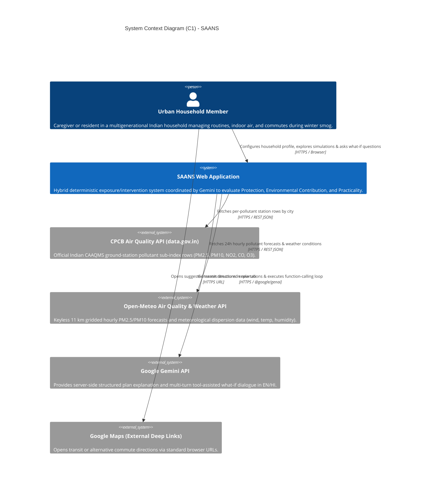
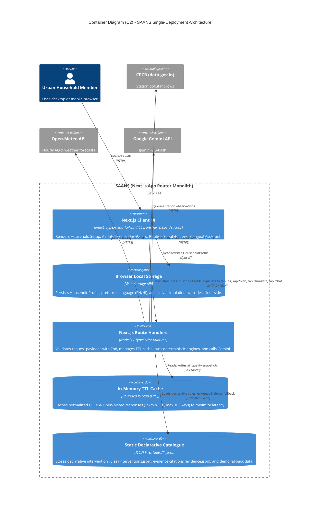
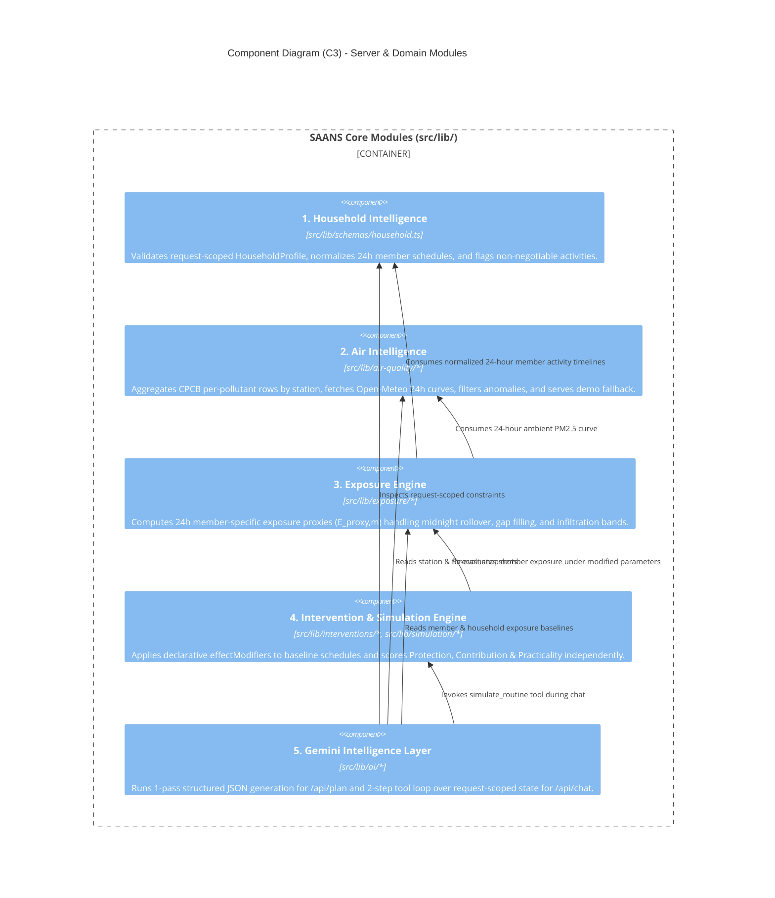

# RFC-001: SAANS (Smart Air Adaptation and Navigation System)

| Metadata | Details |
| --- | --- |
| **RFC ID** | RFC-001 (Rev 2) |
| **Title** | SAANS: Hybrid Deterministic & GenAI Household Winter Smog Decision-Support System |
| **Status** | Approved for Implementation |
| **Target Vertical** | Budget-Conscious Multigenerational Urban Indian Households (Delhi NCR Default) |
| **Evaluation Alignment** | Code Quality (High), Problem Statement Alignment (High), Security (Medium), Efficiency (Medium), Testing & Accessibility (Low) |
| **Repository Constraints** | Public GitHub repository, Single branch (`main`), Total repo size less than 10 MB, Max 3 submission attempts |

---

## 1. Summary & Motivation

During severe winter smog episodes across urban India, families receive raw Air Quality Index (AQI) numbers without actionable guidance tailored to their daily routines, housing constraints, or financial limits. Generic AI chatbots frequently invent unsupported health claims, conflate forecast models with ground measurements, or collapse distinct trade-offs into a single opaque score.

**SAANS (Smart Air Adaptation and Navigation System)** separates **deterministic environmental and exposure modeling** from **Gemini-powered orchestration and explanation**. Five interconnected modules evaluate candidate household interventions across **three strictly separate output dimensions**:

1. **Personal Protection:** Estimated reduction in household $\text{PM}_{2.5}$ exposure ($\Delta E_{\text{proxy}}$), tracked both per member and for the household's peak vulnerable member.
2. **Environmental Contribution:** Estimated avoidance of household-generated emissions (e.g., private vehicle kilometers avoided, indoor solid-fuel or incense combustion eliminated).
3. **Practicality:** Explicit financial cost (INR), daily time impact (minutes/day), and routine inconvenience.

---

## 2. Goals & Non-Goals

### 2.1 Goals

* Model multigenerational household composition, daily schedules, housing ventilation, cooking fuel, and financial/time constraints in a local-first `HouseholdProfile`.
* Distinguish live ground-station observations (**CPCB via `data.gov.in**`) from gridded hourly forecasts (**Open-Meteo Air Quality & Weather APIs**) with explicit timestamps, station metadata, and confidence flags.
* Compute 24-hour complete, member-specific time-activity exposure proxies ($E_{\text{proxy}, m}$) and evaluate interventions using declarative rules (`data/interventions.json`) and traceable literature citations (`data/evidence.json`).
* Use **Google Gemini (`@google/genai`, `gemini-2.5-flash`)** server-side to explain trade-offs in **English or Hindi (`en` / `hi`)** and power an interactive "what-if" assistant via function calling.
* Guarantee full deterministic application functionality when Gemini or upstream APIs are unreachable, while keeping the repository on a single `main` branch under 10 MB.

### 2.2 Non-Goals

* **No Clinical Medical Advice:** SAANS computes environmental exposure proxies ($\mu\text{g/m}^3 \cdot \text{h}$), not biological inhaled doses or medical diagnoses.
* **No Street-Level Pollution Routing in MVP:** Commute interventions use household-entered transport modes and distances, generating standard `[https://www.google.com/maps/dir/](https://www.google.com/maps/dir/)` deep links for transit alternatives.
* **No Server-Side PII Storage:** `HouseholdProfile` persists in browser `localStorage` and is sent as a stateless, Zod-validated request payload to backend endpoints.
* **No Fabricated Tailpipe Emission Factors:** Avoided private vehicle travel is reported directly in vehicle-kilometers avoided per day rather than unverified gram conversions.

---

## 3. System Architecture (C4 Diagrams)

### 3.1 C1: System Context Diagram



### 3.2 C2: Container Diagram



### 3.3 C3: Component Diagram (Five Core Modules)



---

## 4. Detailed Module Design & Domain Contracts

### 4.1 Module 1: Household Intelligence (`src/lib/schemas/household.ts`)

Captures household structure, daily routines, and constraints without storing PII on the server. Because the server is stateless, the client sends the active `HouseholdProfile` inside the JSON body of `POST /api/plan`, `POST /api/simulate`, and `POST /api/chat`.

```typescript
export interface HouseholdProfile {
  location: {
    city: string; // e.g., "Delhi", validated regex /^[a-zA-Z\s.-]{2,60}$/
    areaLabel?: string; // Optional locality for station matching
    latitude: number;   // Default Delhi: 28.6139
    longitude: number;  // Default Delhi: 77.2090
  };
  members: Array<{
    id: string;
    roleLabel: string; // e.g., "School Child", "Commuting Parent", "Older Adult"
    category: "child" | "adult" | "older_adult";
    outdoorSensitivity: "standard" | "higher";
  }>;
  activities: Array<{
    id: string;
    memberId: string;
    type: "school" | "work" | "cooking" | "exercise" | "indoor_rest" | "errands";
    startTime: string; // "HH:MM" (00:00 to 23:59)
    endTime: string;   // "HH:MM" (supports overnight spans where endTime < startTime)
    indoor: boolean;
    transportMode?: "two_wheeler" | "car" | "public_transit" | "walk_cycle" | "none";
    commuteDistanceKm?: number; // 0 to 150
    originLabel?: string;
    destinationLabel?: string;
  }>;
  home: {
    ventilation: "low" | "moderate" | "good";
    cookingFuel: "lpg" | "electric_induction" | "solid_fuel";
    hasOutdoorExhaust: boolean;
    hasAirPurifier: boolean;
    usesIncenseOrCoils: boolean;
  };
  constraints: {
    dailyBudgetInr: number;
    maxExtraTimeMinutesPerDay: number;
    preferredLanguage: "en" | "hi";
    nonNegotiableActivityIds: string[]; // Activities that cannot be time-shifted
  };
}

```

### 4.2 Module 2: Air Intelligence (`src/lib/air-quality/`)

* **CPCB Multi-Row Aggregation (`cpcb.ts`):** The `data.gov.in` CPCB endpoint (`resource_id: 3b01bcb8-0b14-4abf-b6f2-c1bfd384ba69`) returns individual rows per pollutant (`pollutant_id: "PM2.5" | "PM10" | "NO2" | "CO" | "OZONE"`, `pollutant_avg: string`). The adapter filters records by `city`, groups rows by `station`, parses numeric values with `parseFloat` (ignoring `"NA"`), selects the nearest valid station via Haversine distance if coordinates are present, and constructs an observation snapshot (`source: "cpcb"`).
* **Open-Meteo Forecast Adapter (`open-meteo.ts`):** Fetches 24-hour hourly `pm2_5` and `pm10` arrays from the Open-Meteo Air Quality API alongside `wind_speed_10m`, `temperature_2m`, and `relative_humidity_2m` from the Open-Meteo Forecast API (`source: "open_meteo"`).
* **Strict Product Separation & Validation (`validation.ts`):**
* CPCB station observations and Open-Meteo model forecasts are returned as distinct fields (`currentObservation` vs. `hourlyForecast`) and never blended.
* Rejects anomalous readings ($\text{PM}_{2.5} \le 0$, $\text{PM}_{2.5} > 1500\,\mu\text{g/m}^3$, or $\text{PM}_{2.5} > \text{PM}_{10} \times 1.25$).
* Marks observations older than 3 hours as `confidence: "low"`.
* If both live keys/endpoints fail, loads `data/demo-air-quality.json` with `source: "demo"` and sets `isDemoFallback: true` so the UI displays a prominent banner.


```typescript
export interface EnvironmentalContext {
  currentObservation: {
    stationName: string;
    city: string;
    source: "cpcb" | "open_meteo_current" | "demo";
    observedAt: string;
    pm25: number | null;
    pm10: number | null;
    no2: number | null;
    officialNaqi: number | null; // Populated only when CPCB sub-indices are complete
    confidence: "high" | "medium" | "low";
    distanceKm?: number;
  };
  hourlyForecast: Array<{
    hourIndex: number; // 0 to 23
    isoTime: string;
    pm25: number;
    pm10: number;
    windSpeedKmh?: number;
  }>;
  dataQualityWarnings: string[];
}

```

### 4.3 Module 3: Exposure Engine (`src/lib/exposure/`)

Calculates member-specific 24-hour time-activity exposure proxies ($E_{\text{proxy}, m}$ in $\mu\text{g/m}^3 \cdot \text{h}$):

1. **Schedule Normalization & 24-Hour Completeness:**
* **Overnight Splitting:** Any activity where `endTime < startTime` (e.g., `"22:00"` to `"06:00"`) is split into two intervals: `[startTime, "24:00"]` and `["00:00", endTime]`.
* **Sub-Hour Overlap Slicing:** For each hour slot $h \in \{0, \dots, 23\}$ (`[h:00, (h+1):00]`), the engine calculates the exact fraction of the hour $t_{m,h,a} \in [0, 1]$ spent by member $m$ in activity $a$.
* **Default Gap Filling:** Any residual fraction of hour $h$ not covered by an explicit scheduled activity defaults to an implicit `indoor_rest` activity at home ($1.0 - \sum_a t_{m,h,a}$), ensuring every member's timeline sums to **24.0 hours** across both baseline and counterfactual runs.


2. **Concentration Model ($C_{m,h,a}$):**
* **Outdoor Activity (`indoor === false`):** $C_{m,h,a} = C_{\text{outdoor}, h}$ (from `hourlyForecast[h].pm25`), multiplied by a transport micro-environment factor ($1.15$ for `two_wheeler`, $1.0$ for `walk_cycle`/`public_transit`, $0.85$ for closed-window `car`).
* **Indoor Activity (`indoor === true`):** Uses a three-point scenario band (`low`, `central`, `high`):

$$C_{\text{indoor}, h} = F_i \cdot C_{\text{outdoor}, h} + S_i$$


* **Infiltration Band ($F_i$):** Base derived from `home.ventilation` (`low`: `[0.45, 0.55, 0.65]`, `moderate`: `[0.60, 0.70, 0.80]`, `good`: `[0.75, 0.85, 0.95]`). If `home.hasAirPurifier` is true, multiply $F_i$ by `0.50`.
* **Indoor Source Term ($S_i$ in $\mu\text{g/m}^3$):** During `cooking` hours: `+45` (`lpg`), `+5` (`electric_induction`), `+180` (`solid_fuel`), multiplied by `0.35` if `home.hasOutdoorExhaust` is true. If `home.usesIncenseOrCoils` is true, add `+35` during evening hours (`18:00–21:00`).


3. **Member & Household Aggregation:**
* For each member $m$, $E_{\text{proxy}, m} = \sum_{h=0}^{23} \sum_{a} C_{m,h,a} \cdot t_{m,h,a}$.
* Vulnerability flag identifies members with `category !== "adult"` or `outdoorSensitivity === "higher"`.
* Outputs `memberExposures` (keyed by `memberId`), `householdMeanExposure`, and `peakVulnerableMemberExposure` (the primary target for Personal Protection).


### 4.4 Module 4: Intervention & Simulation Engine (`src/lib/interventions/`, `src/lib/simulation/`)

All interventions live in `data/interventions.json` using a declarative `InterventionRule` schema so the engine evaluates them deterministically without hardcoded `eval` logic:

```typescript
export interface InterventionRule {
  id: string;
  title: { en: string; hi: string };
  description: { en: string; hi: string };
  category: "exposure_reduction" | "emission_reduction" | "indoor_air" | "schedule";
  prerequisites: {
    requiresActivityTypes?: Array<"school" | "work" | "cooking" | "exercise" | "errands">;
    applicableTransport?: Array<"two_wheeler" | "car" | "walk_cycle">;
    applicableCookingFuel?: Array<"lpg" | "solid_fuel">;
    requiresIncenseUse?: boolean;
    requiresNoPurifier?: boolean;
    requiresPurifier?: boolean;
  };
  effectModifiers: {
    infiltrationMultiplier?: number;        // e.g., 0.80 for sealing window gaps / wet mopping
    indoorSourceMultiplier?: number;        // e.g., 0.35 for using exhaust hood / stopping incense
    shiftActivityTypesToLowestPmWindow?: Array<"exercise" | "errands">; // Respects nonNegotiableActivityIds
    replaceTransportWith?: "public_transit";
    ventilationWindowOnly?: boolean;        // Restricts cross-ventilation to lowest 3h PM2.5 trough
  };
  practicality: {
    estimatedCostInr: number;
    timeImpactMinutesPerDay: number;
    inconvenienceLevel: "low" | "medium" | "high";
  };
  evidenceRefs: string[]; // Keys into data/evidence.json
}

```

#### Counterfactual Simulation & Three-Pillar Output (`src/lib/simulation/compare.ts`)

For any single intervention or combination of interventions selected in the UI or by Gemini, the simulator clones the baseline `HouseholdProfile`, applies the `effectModifiers` (skipping any schedule shift on activities listed in `constraints.nonNegotiableActivityIds`), re-runs `ExposureEngine`, and returns:

```typescript
export interface EvaluatedIntervention {
  interventionId: string;
  title: string;
  category: InterventionRule["category"];
  // Pillar 1: Personal Protection
  personalProtection: {
    baselineHouseholdMean: number;
    projectedHouseholdMean: number;
    baselinePeakVulnerable: number;
    projectedPeakVulnerable: number;
    deltaPeakExposureProxy: number; // ug/m3*h avoided for most vulnerable member
    relativeReductionPercentRange: [number, number]; // [lowBand%, highBand%]
    confidence: "high" | "medium" | "low";
  };
  // Pillar 2: Environmental Contribution
  environmentalContribution: {
    privateVehicleKmAvoidedPerDay: number;
    indoorCombustionSourceReduced: boolean;
    summary: string;
  };
  // Pillar 3: Practicality
  practicality: {
    estimatedCostInr: number;
    timeImpactMinutesPerDay: number;
    inconvenienceLevel: "low" | "medium" | "high";
    withinHouseholdConstraints: boolean; // Checks dailyBudgetInr & maxExtraTimeMinutesPerDay
    mapsDirectionsUrl?: string; // Populated when replaceTransportWith === "public_transit"
  };
  evidence: Array<{ id: string; sourceTitle: string; claimSummary: string; limitation: string }>;
  assumptions: string[];
}

```

### 4.5 Module 5: Gemini Intelligence Layer (`src/lib/ai/`)

To avoid `@google/genai` conflicts between simultaneous `tools` declarations and `responseSchema` constraints, SAANS uses two distinct execution patterns:

1. **Pattern A — Dashboard Plan Synthesis (`POST /api/plan`):**
* **Single-Pass Pre-Computed Structured Output:** The route handler executes `AirIntelligence`, `ExposureEngine`, and `InterventionEngine` in TypeScript first. It then passes the compact deterministic JSON summary to `gemini-2.5-flash` with `config: { responseMimeType: "application/json", responseSchema: PlanExplanationSchema }` (no `tools` attached).
* **Benefit:** Guaranteed schema compliance, single round-trip latency, low token usage, and zero chance of Gemini hallucinating math.


2. **Pattern B — Interactive What-If Assistant (`POST /api/chat`):**
* **Two-Step Function Calling over Request-Scoped State:** The route handler instantiates request-scoped tool handlers bound to the validated `{ profile, environmentalContext }` payload:
* `get_household_exposure_breakdown`: Returns per-member and per-activity exposure contributions.
* `simulate_custom_routine`: Accepts modified activity times, transport swaps, or intervention IDs, runs `SimulationEngine`, and returns the exact 3-pillar comparison.
* `get_cleanest_outdoor_windows`: Returns the lowest 24h $\text{PM}_{2.5}$ time blocks for a given duration.


* After tool execution completes, Gemini returns the conversational response and structured action cards, which are validated via Zod before returning to the client.


---

## 5. API Surface (`src/app/api/`)

| Endpoint | Method | Request Payload / Query | Response & Resilience Behavior |
| --- | --- | --- | --- |
| `/api/air` | `GET` | `?city=Delhi&lat=28.61&lon=77.20` | Validates query via Zod; checks 15-min TTL cache; fetches CPCB + Open-Meteo; falls back to labeled `data/demo-air-quality.json` on upstream failure. |
| `/api/plan` | `POST` | `{ profile: HouseholdProfile }` | Runs deterministic exposure & intervention engines first; calls Gemini Pattern A (`en` or `hi`). If Gemini fails/times out, returns the complete deterministic plan with template explanations (`aiFallback: true`). |
| `/api/simulate` | `POST` | `{ profile: HouseholdProfile, selectedInterventionIds: string[], activityOverrides?: Activity[] }` | Pure TypeScript execution (under 15 ms, 0 LLM tokens). Powers live interactive sliders and checkboxes in the Routine Simulator. |
| `/api/chat` | `POST` | `{ profile: HouseholdProfile, message: string, history: ChatTurn[] }` | Sanitizes `message` (max 500 chars); runs Gemini Pattern B tool loop over request-scoped `profile`; falls back to deterministic recommendation summary on API error. |

---

## 6. Security, Efficiency & Accessibility Specification

### 6.1 Security (Medium Impact)

* **Server-Only Secrets:** `GEMINI_API_KEY` and `DATA_GOV_API_KEY` are read strictly inside server Route Handlers (`process.env`). Never prefixed with `NEXT_PUBLIC_`.
* **Boundary Validation & Injection Defense:** All route inputs are parsed with strict Zod schemas (`src/lib/schemas/`). User text inputs strip control characters and enforce strict length caps. All external CPCB, Open-Meteo, and Gemini responses are validated before consumption.
* **Local-First Privacy:** Household profiles remain in browser `localStorage` (`saans_household_profile_v1`). No database or analytics tracker stores user schedules.

### 6.2 Efficiency (Medium Impact)

* **Zero-Token Interactive Simulator:** Toggling interventions or shifting schedule hours in the Simulator calls `/api/simulate` (pure TypeScript math), consuming zero Gemini tokens.
* **Bounded LRU Cache:** `src/lib/air-quality/cache.ts` caches normalized `EnvironmentalContext` objects per city/coordinate grid (`0.05°` rounding) for 15 minutes (max 100 entries).
* **Single-Pass Plan Generation:** Pre-computing deterministic metrics before calling Gemini on `/api/plan` cuts LLM latency and token usage by 50% compared to multi-turn agent loops.

### 6.3 Accessibility & Inclusive UX (Low Impact)

* **Non-Color Status Indicators:** Every AQI and Exposure badge pairs high-contrast color coding with explicit text labels (`Severe`, `Very Poor`, `Moderate`) and `lucide-react` icons.
* **Bilingual Support (`EN` / `HI`):** UI labels, deterministic intervention titles (`interventions.json`), and Gemini explanations switch between English and Hindi via `constraints.preferredLanguage`.
* **Semantic Landmarks & Keyboard Navigation:** Full `<main>`, `<nav>`, `<section>`, `aria-label`, and `aria-live="polite"` support on simulation result panels.

---

## 7. Repository Structure & Size Safeguards (Under 10 MB, Single Branch)

To strictly obey the `< 10 MB` repository limit and single-branch (`main`) rule:

* Use `lucide-react` for iconography and `next/font/google` for typography—commit **zero binary images, `.woff2` fonts, or media assets** in `public/`.
* Keep static JSON files (`data/*.json`) concise and human-readable (under 30 KB total).

```text
saans/
├── AGENTS.md                        # Workspace architectural & scientific integrity rules
├── README.md                        # Vertical, Approach & Logic, How It Works, Assumptions
├── .env.example                     # GEMINI_API_KEY, DATA_GOV_API_KEY
├── .gitignore                       # Excludes node_modules, .next, out, coverage, .env*
├── package.json
├── tsconfig.json
├── vitest.config.ts
├── docs/
│   └── RFC.md                       # This specification (RFC-001 Rev 2)
├── data/
│   ├── demo-air-quality.json        # Clearly labeled Delhi winter smog fallback snapshot
│   ├── interventions.json           # Declarative InterventionRule catalogue (EN/HI)
│   └── evidence.json                # Traceable scientific references & limitations
├── src/
│   ├── app/
│   │   ├── layout.tsx               # Accessible shell & navigation
│   │   ├── page.tsx                 # Screen 2: Air Intelligence & Exposure Dashboard
│   │   ├── onboarding/page.tsx      # Screen 1: Household Intelligence Setup
│   │   ├── simulator/page.tsx       # Screen 3: Counterfactual Routine Simulator
│   │   ├── assistant/page.tsx       # Screen 4: Bilingual SAANS AI Assistant
│   │   └── api/
│   │       ├── air/route.ts
│   │       ├── plan/route.ts
│   │       ├── simulate/route.ts
│   │       └── chat/route.ts
│   ├── components/
│   │   ├── dashboard/               # Source-separated AQI cards, 24h chart, member exposure bars
│   │   ├── household/               # Member, routine, home & constraint forms
│   │   ├── recommendations/         # 3-pillar cards (Protection, Contribution, Practicality)
│   │   ├── simulator/               # Interactive schedule & intervention toggles
│   │   └── chat/                    # Bilingual what-if chat + tool citation badges
│   └── lib/
│       ├── ai/
│       │   ├── gemini.ts            # Pattern A (structured plan) & Pattern B (chat tool loop)
│       │   ├── tools.ts             # Request-scoped tool declarations & handlers
│       │   └── prompts.ts           # System instructions enforcing scientific integrity
│       ├── air-quality/
│       │   ├── cpcb.ts              # Multi-row pollutant parser & station grouper
│       │   ├── open-meteo.ts        # Hourly AQ + meteorology fetcher
│       │   ├── normalize.ts         # Combines observation + forecast without blending
│       │   ├── validation.ts        # Anomaly filter & freshness confidence scorer
│       │   └── cache.ts             # Bounded 15-min TTL LRU cache
│       ├── exposure/
│       │   ├── schedule.ts          # Overnight splitter & 24h default gap filler
│       │   ├── indoor-model.ts      # Infiltration (F_i) & source (S_i) band math
│       │   └── calculate.ts         # Member & household time-activity integrator
│       ├── interventions/
│       │   ├── catalogue.ts         # Loads & validates interventions.json + evidence.json
│       │   └── evaluate.ts          # Prerequisite matcher & 3-pillar evaluator
│       ├── simulation/
│       │   └── compare.ts           # Applies declarative effectModifiers & computes deltas
│       ├── schemas/
│       │   └── index.ts             # Zod schemas for HouseholdProfile, APIs, and AI outputs
│       └── storage/
│           └── profile-store.ts     # Safe browser localStorage read/write + default Delhi preset
└── tests/
    ├── exposure.test.ts             # Tests overnight rollover, 24h gap fill, & F_i/S_i bands
    ├── simulation.test.ts           # Tests counterfactual deltas & non-negotiable lock
    ├── interventions.test.ts        # Tests eligibility filtering & 3-pillar independence
    └── data-validation.test.ts      # Tests CPCB multi-row parsing, anomaly rejection & fallback

```

---

## 8. Implementation Milestones & Verification Plan

### 8.1 Sequential Build Milestones (for Google Antigravity)

1. **Milestone 1 — Schemas, Curated Data & Deterministic Engines:**
* Create `src/lib/schemas/index.ts`, `data/evidence.json`, `data/interventions.json`, and `data/demo-air-quality.json`.
* Implement `src/lib/exposure/*`, `src/lib/interventions/*`, and `src/lib/simulation/*`.
* Write and pass all Vitest unit tests in `tests/`.


2. **Milestone 2 — Air Intelligence & Server API Layer:**
* Implement `src/lib/air-quality/*` (CPCB multi-row grouper, Open-Meteo adapter, validator, TTL cache) and `src/lib/ai/*` (Pattern A & Pattern B Gemini handlers with deterministic fallback).
* Implement `/api/air`, `/api/plan`, `/api/simulate`, and `/api/chat`.


3. **Milestone 3 — Four-Screen Frontend & Local Persistence:**
* Build `profile-store.ts` with a realistic pre-loaded Delhi multigenerational family default so evaluators see an active dashboard immediately upon launch without tedious form entry.
* Build the Dashboard (`/`), Household Setup (`/onboarding`), Routine Simulator (`/simulator`), and Bilingual Assistant (`/assistant`).


4. **Milestone 4 — Documentation & Submission Audit:**
* Write `README.md` covering the four required submission sections (Chosen Vertical, Approach & Logic, How the Solution Works, Assumptions Made).
* Run `npx vitest run`, `npm run build`, single-branch check (`git branch -a`), and repo size check (`du -sh .`).

