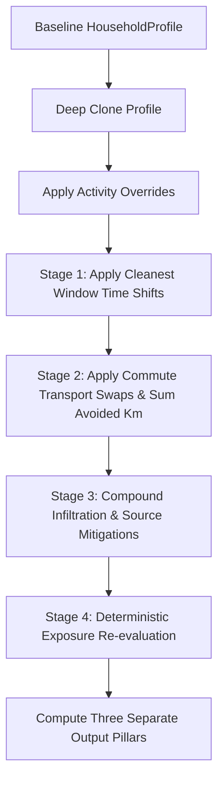

# Specification 2: Avir Intervention & Counterfactual Simulation Engine

| Metadata | Details |
| --- | --- |
| **Document ID** | SPEC-AVIR-002 |
| **Title** | Declarative Interventions, Counterfactual Simulation & Three Pillars Output |
| **System** | Avir (Smart Air Adaptation and Navigation System) |
| **Status** | Approved Design / Ready for Implementation Plan |
| **Author** | Antigravity AI Assistant & Engineering Team |
| **Date** | 2026-11-17 |

---

## 1. Executive Summary

This specification establishes the deterministic intervention evaluation and counterfactual routine simulation engine for **Avir**. Operating on validated `HouseholdProfile` and `EnvironmentalContext` inputs, it determines intervention eligibility, schedules activity shifts, applies micro-environmental modifiers, and projects household outcomes across **three strictly separate output dimensions**:

1. **Personal Protection:** Estimated reduction in peak vulnerable member exposure proxy ($\Delta E_{\text{proxy, peak}}$) and household mean reduction bounds ($[ \text{low}\%, \text{high}\% ]$).
2. **Environmental Contribution:** Avoided private on-road vehicle travel (`privateVehicleKmAvoidedPerDay`) and indoor combustion elimination. Strictly zero fabricated tailpipe gram emission factors.
3. **Practicality:** INR financial expenditure, daily time impact in minutes, inconvenience level, constraint validation, and Google Maps transit deep links.

It also provides the zero-token `POST /api/simulate` Next.js Route Handler (< 15 ms latency) and an interactive visual diagnostic harness (`scripts/verify-simulation.ts`).

---

## 2. Architectural Boundaries & Non-Negotiable Directives

In accordance with `AGENTS.md` and `RFC.md`:

* **Three Pillars Are Never Combined:** The system must never aggregate Personal Protection, Environmental Contribution, and Practicality into a single composite score or index.
* **Deterministic Engine Purity (`src/lib/interventions/`, `src/lib/simulation/`):**
  * Zero network calls, zero `fetch`, zero reading `process.env`.
  * Zero `@google/genai` imports.
  * Zero browser API access (`window`, `localStorage`).
  * Pure TypeScript operating exclusively on Zod-validated input arguments.
* **Non-Negotiable Activity Invariant:** Any activity whose `id` appears in `profile.constraints.nonNegotiableActivityIds` is strictly locked. The engine will never shift its start or end time.
* **Honest Environmental Accounting:** Avoided emissions are reported directly in `privateVehicleKmAvoidedPerDay`. No arbitrary emission factor conversions.

---

## 3. Directory & File Manifest

```text
src/
├── app/
│   └── api/
│       └── simulate/
│           └── route.ts             # POST handler: parses request, runs simulation, returns typed JSON
├── lib/
│   ├── schemas/
│   │   └── simulation.ts            # Zod schemas for SimulateRequest, EvaluatedIntervention & SimulationResult
│   ├── interventions/
│   │   ├── catalogue.ts             # In-memory loader & prerequisite eligibility matcher
│   │   ├── evaluate.ts              # Maps InterventionRule + Profile -> EvaluatedIntervention
│   │   └── index.ts                 # Barrel exports
│   └── simulation/
│       ├── time-shift.ts            # Finds lowest PM2.5 trough & reschedules activities
│       ├── compare.ts               # Staged multi-intervention pipeline & delta computer
│       └── index.ts                 # Barrel exports
scripts/
└── verify-simulation.ts             # Formatted ASCII CLI harness testing Delhi multigenerational preset
tests/
├── interventions.test.ts            # Prerequisite matching & single intervention evaluation tests
└── simulation.test.ts               # Multi-intervention composition, non-negotiable locks & bounds
```

---

## 4. Simulation Schemas (`src/lib/schemas/simulation.ts`)

```typescript
import { z } from "zod";
import { HouseholdProfileSchema, ActivitySchema } from "./household";
import { InterventionCategorySchema, InconvenienceLevelSchema } from "./interventions";

export const PersonalProtectionResultSchema = z.object({
  baselineHouseholdMean: z.number(),
  projectedHouseholdMean: z.number(),
  baselinePeakVulnerable: z.number(),
  projectedPeakVulnerable: z.number(),
  deltaPeakExposureProxy: z.number(), // Negative indicates reduction in exposure proxy
  relativeReductionPercentRange: z.tuple([z.number(), z.number()]), // [low%, high%]
  confidence: z.enum(["high", "medium", "low"]),
});

export const EnvironmentalContributionResultSchema = z.object({
  privateVehicleKmAvoidedPerDay: z.number().min(0),
  indoorCombustionSourceReduced: z.boolean(),
  summary: z.string(),
});

export const PracticalityResultSchema = z.object({
  estimatedCostInr: z.number().min(0),
  timeImpactMinutesPerDay: z.number(),
  inconvenienceLevel: InconvenienceLevelSchema,
  withinHouseholdConstraints: z.boolean(),
  mapsDirectionsUrl: z.string().url().optional(),
});

export const EvaluatedInterventionSchema = z.object({
  interventionId: z.string(),
  title: z.string(),
  description: z.string(),
  category: InterventionCategorySchema,
  personalProtection: PersonalProtectionResultSchema,
  environmentalContribution: EnvironmentalContributionResultSchema,
  practicality: PracticalityResultSchema,
  evidence: z.array(
    z.object({
      id: z.string(),
      sourceTitle: z.string(),
      claimSummary: z.string(),
      limitations: z.string(),
    })
  ),
  assumptions: z.array(z.string()),
});

export const SimulateRequestSchema = z.object({
  profile: HouseholdProfileSchema,
  selectedInterventionIds: z.array(z.string()).default([]),
  activityOverrides: z.array(ActivitySchema).optional(),
});

export const SimulationResultSchema = z.object({
  counterfactualProfile: HouseholdProfileSchema,
  evaluatedInterventions: z.array(EvaluatedInterventionSchema),
  combinedPersonalProtection: PersonalProtectionResultSchema,
  combinedEnvironmentalContribution: EnvironmentalContributionResultSchema,
  combinedPracticality: PracticalityResultSchema,
  assumptions: z.array(z.string()),
});

export type PersonalProtectionResult = z.infer<typeof PersonalProtectionResultSchema>;
export type EnvironmentalContributionResult = z.infer<typeof EnvironmentalContributionResultSchema>;
export type PracticalityResult = z.infer<typeof PracticalityResultSchema>;
export type EvaluatedIntervention = z.infer<typeof EvaluatedInterventionSchema>;
export type SimulateRequest = z.infer<typeof SimulateRequestSchema>;
export type SimulationResult = z.infer<typeof SimulationResultSchema>;
```

---

## 5. Prerequisite Matching & Intervention Catalogue (`src/lib/interventions/`)

### 5.1 Eligibility Filter (`catalogue.ts`)

An intervention is considered applicable if and only if all declared prerequisites are met:

```typescript
export function isInterventionApplicable(rule: InterventionRule, profile: HouseholdProfile): boolean {
  const { prerequisites } = rule;

  if (prerequisites.requiresActivityTypes && prerequisites.requiresActivityTypes.length > 0) {
    const hasActivity = profile.activities.some((a) =>
      prerequisites.requiresActivityTypes?.includes(a.type)
    );
    if (!hasActivity) return false;
  }

  if (prerequisites.applicableTransport && prerequisites.applicableTransport.length > 0) {
    const hasTransport = profile.activities.some(
      (a) => a.transportMode && prerequisites.applicableTransport?.includes(a.transportMode)
    );
    if (!hasTransport) return false;
  }

  if (prerequisites.applicableCookingFuel && prerequisites.applicableCookingFuel.length > 0) {
    if (!prerequisites.applicableCookingFuel.includes(profile.home.cookingFuel)) {
      return false;
    }
  }

  if (prerequisites.requiresIncenseUse === true && !profile.home.usesIncenseOrCoils) {
    return false;
  }

  if (prerequisites.requiresNoPurifier === true && profile.home.hasAirPurifier) {
    return false;
  }

  if (prerequisites.requiresPurifier === true && !profile.home.hasAirPurifier) {
    return false;
  }

  return true;
}
```

### 5.2 Single Evaluator & Deep Link Construction (`evaluate.ts`)

When constructing the Google Maps transit deep link:
```typescript
export function buildMapsDirectionsUrl(origin?: string, destination?: string): string | undefined {
  if (!origin || !destination) return undefined;
  const baseUrl = "https://www.google.com/maps/dir/?api=1";
  const params = new URLSearchParams({
    origin,
    destination,
    travelmode: "transit",
  });
  return `${baseUrl}&${params.toString()}`;
}
```

---

## 6. Counterfactual Simulation Engine (`src/lib/simulation/`)

### 6.1 Cleanest Window Rescheduling (`time-shift.ts`)

1. **Duration Calculation:** For activity $a$ spanning $[t_{\text{start}}, t_{\text{end}}]$, calculate duration $D = t_{\text{end}} - t_{\text{start}}$ (handling overnight wrapping if needed).
2. **Rolling Window Optimization:** Over hourly forecast points $h \in \{0, \dots, 23\}$, find start hour $h^*$ minimizing:
   $$\bar{C}_{\text{outdoor}}(h^*) = \frac{1}{\lceil D \rceil} \sum_{i=0}^{\lceil D \rceil - 1} C_{\text{outdoor}}[(h^* + i) \bmod 24]$$
3. **Shift Execution:**
   * If `profile.constraints.nonNegotiableActivityIds.includes(a.id)`: **DO NOT MOVE**.
   * Otherwise: set `a.startTime = formatTime(h*)` and `a.endTime = formatTime(h* + D)`.

### 6.2 Staged Composition Pipeline (`compare.ts`)

When $K$ interventions are selected simultaneously, they execute through 4 staged steps:



1. **Stage 1: Schedule Adjustments:**
   Applies time shifts for all interventions specifying `shiftActivityTypesToLowestPmWindow`, respecting `nonNegotiableActivityIds`.
2. **Stage 2: Transport Swaps:**
   For interventions with `replaceTransportWith: "public_transit"`:
   * Sets `a.transportMode = "public_transit"`.
   * Adds `a.commuteDistanceKm` to `privateVehicleKmAvoidedPerDay`.
3. **Stage 3: Compounding Environmental Modifiers:**
   * Infiltration multiplier: $\prod M_{\text{inf}}$, clamped to physical lower bound $0.20$.
   * Source mitigations:
     * If incense stopped: `home.usesIncenseOrCoils = false`.
     * If fuel switched: `home.cookingFuel = "electric_induction"`.
     * If exhaust enabled: `home.hasOutdoorExhaust = true`.
4. **Stage 4: Three-Pillar Delta Computation:**
   * Re-evaluates `calculateHouseholdExposure` on modified profile.
   * Personal Protection:
     $$\Delta E_{\text{proxy, peak}} = E_{\text{projected, peak}} - E_{\text{baseline, peak}}$$
   * Practicality:
     $$\text{Total Cost} = \sum \text{estimatedCostInr}, \quad \text{Total Time} = \sum \text{timeImpactMinutesPerDay}$$
     $$\text{withinHouseholdConstraints} = (\text{Total Cost} \le \text{dailyBudgetInr}) \land (\text{Total Time} \le \text{maxExtraTimeMinutesPerDay})$$

---

## 7. Next.js Route Handler (`src/app/api/simulate/route.ts`)

```typescript
import { NextRequest, NextResponse } from "next/server";
import { SimulateRequestSchema } from "@/lib/schemas/simulation";
import { simulateRoutine } from "@/lib/simulation";
import demoAir from "../../../../data/demo-air-quality.json";

export async function POST(req: NextRequest) {
  try {
    const json = await req.json();
    const parsed = SimulateRequestSchema.safeParse(json);
    if (!parsed.success) {
      return NextResponse.json({ error: "Invalid payload", issues: parsed.error.issues }, { status: 400 });
    }

    const { profile, selectedInterventionIds, activityOverrides } = parsed.data;
    const result = simulateRoutine(profile, selectedInterventionIds, demoAir.hourlyForecast, activityOverrides);

    return NextResponse.json(result);
  } catch (err: unknown) {
    const message = err instanceof Error ? err.message : "Internal simulation error";
    return NextResponse.json({ error: message }, { status: 500 });
  }
}
```

---

## 8. Testing & Diagnostic Verification

### 8.1 Visual Diagnostic Harness (`scripts/verify-simulation.ts`)

Executable via `npm run verify:simulation`. Validates:
1. Delhi Multigenerational preset with 4 stacked interventions (Metro swap, window tape, exercise shift, incense elimination).
2. Prints formatted ASCII comparison of all 3 pillars side-by-side.
3. Checks invariants and exits with code 0 on success, code 1 on failure.

### 8.2 Vitest Suites

* `tests/interventions.test.ts`: Prerequisite matching, evidence link integrity, Google Maps URL encoding.
* `tests/simulation.test.ts`: Non-negotiable activity hard lock, physical infiltration clamping ($\ge 0.20$), budget constraint boundary checks, honest vehicle km accounting.

### 8.3 Exact Verification Commands

```bash
npm run verify:simulation
npx vitest run tests/interventions.test.ts tests/simulation.test.ts
npx tsc --noEmit
```
